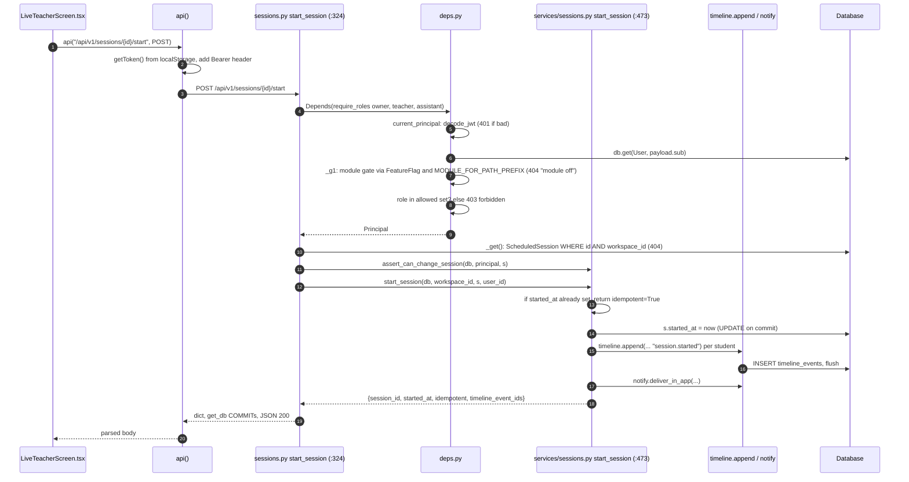

# UI → Database walkthrough (login, then "Start class")

Every file and line below was read from this repo, and the login responses were captured by running the app in-process (`TestClient`, SQLite). Interactive version: [walkthrough-ui-to-db.html](walkthrough-ui-to-db.html).

## 0. The Python mental model

| Concept | Where | What it does |
|---|---|---|
| App object | `backend/app/main.py:3` → `factory.py:37 create_app()` | Builds one `FastAPI()`, adds middleware, runs `init_db()` + seed, mounts routers. Uvicorn imports `app.main:app`. |
| Middleware | `factory.py:54-61`, `middleware/*.py` | Wraps *every* request. Last added = outermost, so the order is CORS → RequestId → Idempotency → router. |
| Router | `api/v1/<name>.py` → `router = APIRouter()` | A group of endpoints. `factory.py:73-95` mounts each with prefix `/api/v1`. |
| Pydantic model | `class PasswordIn(BaseModel)` in `auth.py:37` | Request-body schema. FastAPI parses JSON into it, or returns **422** without calling your function. |
| `Depends(...)` | `auth.py` parameters | FastAPI calls the dependency first and injects its return value as the argument. This is how the DB session, current user, and role checks are shared. |
| `get_db` | `db.py:129` | A generator dependency. It opens a SQLAlchemy `Session`, `yield`s it, then **commits** if the endpoint returned, **rolls back** on exception, and always closes. Endpoints never call `commit()` themselves. They call `flush()` to get ids. |
| `current_principal` | `api/v1/deps.py:54` | Reads `Authorization: Bearer <jwt>`, verifies it, returns `Principal(user_id, workspace_id, role, display_name)`. |
| `require_roles(...)` | `deps.py:97` | A factory returning a dependency that wraps `current_principal` and raises **403** if the role is not allowed. |
| Service | `backend/app/services/*.py` | Business logic taking `(db, principal/ids, ...)`. Routers stay thin (CLAUDE.md rule 6). |
| Model | `backend/app/models/tables.py` | SQLAlchemy ORM tables. Every business table has `workspace_id`. |
| Port | `backend/app/ports/mocks.py` | Vendor edges (SMS, email, video). The mock records calls in a list and never contacts a vendor. Injected via `Depends(ports_dep)`. |

**Layering rule of thumb:** router parses and authorises → service decides → models persist → port talks to the outside world.

## 1. Flow A: user clicks "Sign in" (username + password)

```mermaid
sequenceDiagram
    autonumber
    actor U as User
    participant LG as LoginGate.tsx
    participant API as lib/api.ts api()
    participant MW as Middleware (CORS, RequestId, Idempotency)
    participant R as auth.py password_login
    participant DB as get_db Session
    participant S as services/auth.py
    participant PG as Database
    participant LS as localStorage

    U->>LG: click "Sign in" (form onSubmit)
    LG->>LG: onPassword(): preventDefault, setBusy(true)
    LG->>API: api("/api/v1/auth/password", POST, body)
    API->>API: add Content-Type, no token yet
    API->>MW: fetch http://127.0.0.1:8000/api/v1/auth/password
    MW->>MW: CORS preflight OPTIONS then POST; set request_id
    MW->>R: route match POST /api/v1/auth/password
    R->>R: Pydantic PasswordIn validation (else 422)
    R->>DB: Depends(get_db) opens Session
    R->>PG: SELECT identities WHERE kind=username AND value AND workspace_id
    R->>PG: db.get(User, ident.user_id)
    R->>S: password_matches(user.password_hash, password)
    S-->>R: pbkdf2_hmac compare_digest True/False
    alt wrong user or password
        R-->>API: HTTPException 401 "unknown username or password"
        DB->>DB: rollback and close
    else ok
        R->>S: role_in_workspace(db, user.id, workspace_id)
        S->>PG: SELECT staff_memberships, else students, else parent_links
        S-->>R: "teacher"
        R->>S: issue_session(db, user, workspace_id, role)
        S->>S: encode_jwt: sub, workspace_id, role, jti (HS256)
        S->>PG: INSERT sessions_auth (token_jti) then flush
        S-->>R: token
        R-->>MW: {token, role, workspace_id}
        DB->>PG: COMMIT (get_db after yield)
    end
    MW-->>API: 200 JSON + x-request-id header
    API-->>LG: parsed body, or throw Error("401 ...")
    LG->>LS: setToken(token) key tutoros_token
    LG->>LG: setAuthed(true) then render children
```

### Step-by-step, with code locations

| # | Layer | File:line | What happens |
|---|---|---|---|
| 1 | Browser UI | `frontend/components/LoginGate.tsx:60-87` | On mount, `check()` finds no token in `localStorage`, so `authed=false` and the form shows. If a token exists it calls `GET /auth/me` and clears the token if the role is wrong. |
| 2 | Browser UI | `LoginGate.tsx:236`, `:168` | `<form onSubmit={onPassword}>`. Calls `e.preventDefault()`, `setBusy(true)`, then `api(...)` with `{username, password, workspace_id}`. |
| 3 | Frontend lib | `frontend/lib/api.ts:8-25` | Sets JSON content type, attaches `Authorization: Bearer` if a token is stored, calls `fetch(API_BASE + path)`. `API_BASE` defaults to `http://127.0.0.1:8000` (`NEXT_PUBLIC_API_BASE`). Non-2xx throws `Error("<status> <body>")`. |
| 4 | Network | n/a | The browser is on `:3000` and the API on `:8000`, so it is cross-origin. CORS answers the preflight (`allow_origins=["*"]`, `factory.py:56-61`). |
| 5 | ASGI server | `backend/app/main.py:3` | `app = create_app()` is what uvicorn serves. |
| 6 | Middleware | `middleware/request_id.py`, `idempotency.py` | RequestId stores `request.state.request_id` and echoes `x-request-id`. Idempotency only stores the header on `request.state` (nothing consumes it yet). |
| 7 | Routing | `factory.py:73`, `auth.py:79` | `include_router(auth.router, prefix="/api/v1")` plus `@router.post("/auth/password")` gives `POST /api/v1/auth/password`. |
| 8 | Validation + DI | `auth.py:37`, `db.py:129` | `body: PasswordIn` is parsed from JSON. `db: Session = Depends(get_db)` opens the session. |
| 9 | Router body | `auth.py:80-92` | Query `Identity(kind="username", value, workspace_id)`, load `User`, check `password_matches`. Failure raises `HTTPException(401)`. |
| 10 | Service | `services/auth.py:20-27` | `hash_password` is PBKDF2-SHA256 (120k rounds, fixed salt). `compare_digest` is a constant-time compare. |
| 11 | Service | `services/auth.py:94-116` | `role_in_workspace` checks `StaffMembership`, then `Student`, then accepted `ParentLink`. |
| 12 | Service + model | `services/auth.py:129-140`, `tables.py:48` | `encode_jwt` signs `{sub, workspace_id, role, jti}` with `jwt_secret`. A `SessionAuth` row with the `jti` is added and `flush()`ed. |
| 13 | DB boundary | `db.py:129-136` | The endpoint returns a dict. `get_db` resumes after `yield` and **commits**. FastAPI serialises the dict to JSON. |
| 14 | Browser | `LoginGate.tsx:177-182`, `lib/session.ts:35` | Checks the role is allowed for this screen, `localStorage.setItem("tutoros_token", …)`, `setAuthed(true)`, then `{children}` renders. |

Captured live (seed data, `exam-prep` workspace):

```text
POST /api/v1/auth/password {"username":"sudhakshina","password":"TutorDemo1","workspace_id":"aaaaaaaa-0001-…"}
→ 200 {"token":"eyJ…","role":"teacher","workspace_id":"aaaaaaaa-0001-…"}   + x-request-id header
JWT payload → {"sub":"bbbbbbbb-0001-…011","workspace_id":"aaaaaaaa-0001-…","role":"teacher","jti":"4eba…"}
wrong password → 401 {"detail":"unknown username or password"}
missing field  → 422 {"detail":[{"type":"missing","loc":["body","password"],…}]}
GET /auth/me without token → 401 {"detail":"sign in"}
```

Notes about the code, so it doesn't surprise you:

- The JWT has **no expiry** (`encode_jwt` sets no `exp`), and `sessions_auth.token_jti` is written but never checked on later requests. Logout is just clearing localStorage. This is fine for a sim spine, not for production.
- The other login routes (`/auth/otp/start`, `/auth/otp/verify`, `/auth/magic-link`, `auth.py:49-108`) end the same way: `issue_session()` then `{token, role, workspace_id}`. The OTP code is always `settings.otp_code` (`000000`), and the SMS goes through `MockPorts.send_sms`, which just appends to a list.

## 2. Flow B: every request after login (what `Authorization: Bearer` triggers)

Teacher clicks **Start class** on the live screen:
`frontend/components/wired/LiveTeacherScreen.tsx:129` calls `api(\`/api/v1/sessions/${sessionId}/start\`, {method:"POST"})`.



Where each gate lives:

| Gate | Code | Failure |
|---|---|---|
| Missing/short header | `deps.py:54-60` | 401 `sign in` |
| Bad signature | `services/auth.py:49-54` | 401 `invalid session` |
| User deleted | `deps.py:62-64` | 401 `unknown user` |
| Module switched off for this workspace/staff | `deps.py:76-94` (`_g1`) using `MODULE_FOR_PATH_PREFIX` (`/api/v1/sessions` → module `B1`) | 404 `module off` |
| Wrong role | `deps.py:97-103` | 403 `forbidden` |
| Row in another workspace | `sessions.py:82-90` (`_get` filters `workspace_id`) | 404 `session` |
| Not your class | `services/sessions.py:276` | 403 |

**Tenant isolation lives here:** `workspace_id` comes from the signed JWT, never from the request body, and every query filters on it.

## 3. Recipe: how to follow any button in this repo

1. Find the click handler in `frontend/components/**` (or `frontend/components/wired/**`) and note the `api("/api/v1/...", {method})` call.
2. `grep -rn '"/xyz"' backend/app/api/v1` to find the `@router.<verb>("/xyz")`. The file name is the topic (`sessions.py`, `students.py`…).
3. Read the function signature: `body: SomeIn` is the JSON schema, `Depends(require_roles(...))` is who may call it, and `Depends(get_db)` means it touches the DB.
4. The body calls `services/<topic>.py`. Read that for the real logic.
5. Services touch `models/tables.py` tables via `db.query(...)`, `db.add(...)`, `db.flush()`.
6. Return a dict (or raise `HTTPException`). `get_db` commits or rolls back.
7. Tests for the same route are in `backend/tests/` (`conftest.py` provides the `client` fixture: in-memory SQLite, mock ports).

Run it yourself: `cd backend && python -m uvicorn app.main:app --reload`, then open `http://127.0.0.1:8000/docs` for FastAPI's built-in interactive API explorer.

## 4. The 8 patterns (all 138 endpoints)

Every endpoint behind the UI is one of eight shapes. Pick the pattern first, then read the matching handler. Interactive version with per-pattern flows, code, route lists and a comparison table: [walkthrough-patterns.html](walkthrough-patterns.html).

| # | Pattern | Routes | Recognise it by | Example |
|---|---|---|---|---|
| P1 | Public sign-in | 5 | No `current_principal`; ends in `issue_session()` | `POST /auth/password` |
| P2 | Read a screen | 57 | `GET`, `useEffect` load, workspace-filtered query, no writes | `GET /students` |
| P3 | Save a form | 33 | Body model, `db.add` + `flush`, returns the row | `POST /cohorts` |
| P4 | Action with ledger and channels | 15 | `timeline.append` then `notify.*` (QuotaGuard, mock port, audit) | `POST /announcements` |
| P5 | Move a record through its lifecycle | 9 | Check state, 409 if illegal, set `status`, `audit()` | `POST /invoices/{id}/approve` |
| P6 | Call a vendor edge (port) | 5 | `Depends(ports_dep)` then `ports.*` (always mock) | `POST /sessions/{id}/video-link` |
| P7 | Change workspace rules | 8 | Owner-only write to a setting that `_g1` / QuotaGuard reads on later requests | `PUT /owner/faculty-access/{id}` |
| P8 | Stay in sync (polling) | 6 | `setInterval` GET (board 4s, chat 8s, inbox 15s); merging PUT | `GET/PUT /sessions/{id}/board` |

How the routes were assigned: each handler's source and the service functions it calls (two levels deep) were scanned for timeline writes, notifications, port calls, status changes, audit rows and quota checks, then the result was reviewed by hand. A route is placed by its dominant effect. Mixed ones: `PATCH /sessions/{id}` (form + ledger + guards), `POST /invoices/{id}/refund` (lifecycle + ledger), `POST /payments/checkout` (lifecycle + port + ledger).

Line numbers are as of the working tree when this was written. That tree has uncommitted edits from outside this task (for example `services/sessions.py`, `students.py`, `factory.py`), so re-check a line number if it has drifted.
